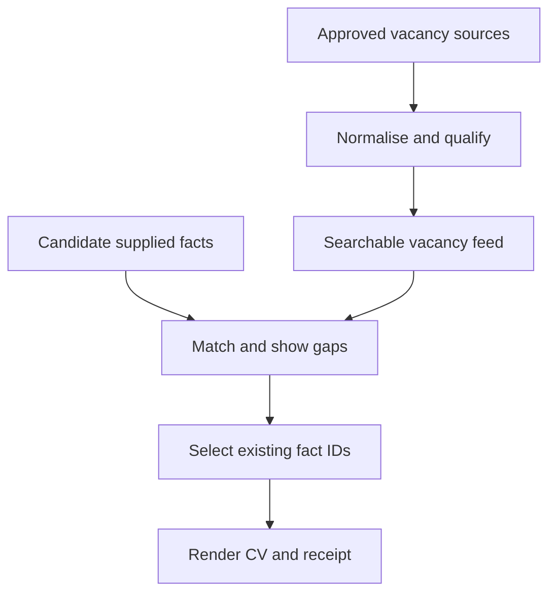

# PDS 6 design and requirement mapping

Version 0.1.0 · 2 November 2026 · Author: Rama Chandra Malayanur / AI Evaluation Lab

## Problem and user

The Army Design Compendium 2025 describes the time spent manually finding relevant employment opportunities for ex-servicemen and preparing job-specific CVs. PDS 6 (printed page 9) requests a job aggregator and a CV-generation application, with an envisaged connection to existing AWPO candidate data.

SevaSetu Careers implements a demonstrable, local-first slice of that workflow. A candidate or placement counsellor can inspect sources, assess structured requirements, and prepare a factual CV. This is an independent response to a published problem, not an awarded Army project. Current problem availability and intake must be confirmed separately.

## Requirement traceability

| Published need | Implemented output | Remaining dependency |
| --- | --- | --- |
| Aggregate internet vacancies relevant to ex-servicemen | Public HTTPS JSON / JobPosting JSON-LD ingestion, local feed import, deduplication, explicit ESM filter and source/lifecycle reporting | Authorised official/employer sources and ESM-specific field mappings; no general web crawler is claimed |
| Find suitable roles | Corpus-derived TF-IDF retrieval, explicit skill mappings, location and qualification-gap checks | Consented relevance labels, actual candidate/counsellor feedback, calibrated semantic ranker |
| Generate job-specific CVs | Relevance-based fact ordering, verbatim fact rendering, local AI fact selection option, TXT and print/PDF export | Live model evaluation, readable output review and approved candidate data |
| Use existing AWPO candidate data | Candidate JSON schema, local import and stable fact IDs | AWPO permission, schema mapping, consent and minimisation agreement; no database integration claimed |

## Data flow

The CLI fetcher and browser core are separate. The browser contains no remote AI call, telemetry, form backend or credential. A profile remains in the tab unless a user explicitly downloads it. A static-hosting provider still receives normal requests for the application assets; that does not include the profile.

## Source and lifecycle rules

- Only configured HTTPS endpoints are fetched. Exact hostname approval, public-address checks and pinned DNS prevent the importer from becoming an arbitrary internal-network fetcher. Redirects require a new explicitly configured canonical URL.
- A source snapshot is an observation, not proof that an employer's vacancy is still available. Original timestamps are preserved across imports. Failures and rejected records remain inspectable in the CLI report.
- Tracking URLs and identical employer/title/location records are deduplicated. Conflicting deadlines or structured requirements enter manual review. A closed/withdrawn source observation is retained conservatively.
- Date-only deadlines end at 23:59:59.999 IST. Ambiguous dates, impossible dates and future timestamps are not treated as current openings. Explicitly expired/withdrawn records and observations older than seven days are withheld.
- JSON-LD prose is not automatically translated into confident structured eligibility. ESM eligibility, application mode, age, rank and credential equivalence require review and source-specific mappings.

## Retrieval and claims

Matching is a deterministic baseline: 60% declared-skill coverage, 30% TF-IDF cosine relevance and 10% candidate location/remote compatibility. With an explicit query, text relevance receives 55% and skill coverage 35%; at least one query token must match. A missing structured qualification caps the relevance score at 39. A score is neither a probability nor an employer eligibility decision. Corpus changes can change scores.

Skill aliases are explicit and inspectable. They assist retrieval; rank does not confer a degree, certificate or civilian licence. Education equivalence is conservative, especially for diplomas. Experience durations from separate roles are not added, because they may overlap. Profile fields and facts remain self-declared.

The optional Ollama adapter receives a role and fact objects, excluding candidate name/contact. It returns fact IDs in a JSON schema. The core rejects extra keys/prose, unknown or duplicate IDs, and omission of supplied education/certificates. The renderer obtains text from validated profile facts; model-generated text never enters a CV claim. Prompt injection can still distort selection/ranking, but cannot add candidate prose through this interface. Candidate review remains required.

Every receipt contains the selected claim text and fact IDs, requirement assessment, source observations, and hashes of the CV text and normalised profile. SHA-256 is an integrity checksum, not a signature, authority attestation or credential verification. It should never be described as Army validation.

## Verification and limits

`npm test` exercises normal and adverse input. `npm run evaluate` reproduces three author-labelled synthetic cases and hashes its inputs. The sample feed has 15 records: 13 unique valid listings, one duplicate and one invalid record. Of the 13, ten are within their sample deadlines, one is expired, one is stale and one lacks a deadline.

These small controlled examples do not support placement-rate, accuracy, fairness, multilingual-quality or production-readiness claims. A live local model, real vacancy transport and a consented user study are separate validations. See the release evidence for what was actually run.

## Sources checked on 2 November 2026

- Army Design Bureau / FICCI, [Army Design Compendium 2025](https://bharatshakti.in/wp-content/uploads/2025/02/ARMY-DESIGN-COMPENDIUM-2025-BSI.pdf), PDS 6, printed page 9; response guidelines, printed pages xxviii–xxix. Public mirror of the Army-authored document.
- National Portal of India, [AWPO service description](https://www.india.gov.in/category/defence-foreign-affairs/subcategory/defence/details/website-of-army-welfare-placement-organisation). It describes placement, registration and career support; it is not a data-access permission.
- DGR, [employment assistance FAQ](https://dgrindia.gov.in/writereaddata/media/documents/f9c35c2b-dbf4-4a51-a121-68f53b507935.pdf). Vacancies and the correct application route need checking on the advertisement.
- [Schema.org JobPosting](https://schema.org/JobPosting), for the optional structured vacancy adapter.
- [Ollama Generate API](https://docs.ollama.com/api/generate), for the optional local structured-output selector.
- [iDEX FAQ](https://idex.gov.in/faq) and [challenge listing](https://idex.gov.in/challenges). Intake status must be confirmed: the listing displayed Open Challenge closed at 30 September 2026 while the FAQ described year-round intake.

Research did not establish usable AWPO/DGR data access. Direct AWPO and DGR retrieval attempts returned service errors in this environment. A DGR-like site at dgrconnect.in explicitly identifies itself as staging/testing and was excluded as a live source. No source access restriction was bypassed.
