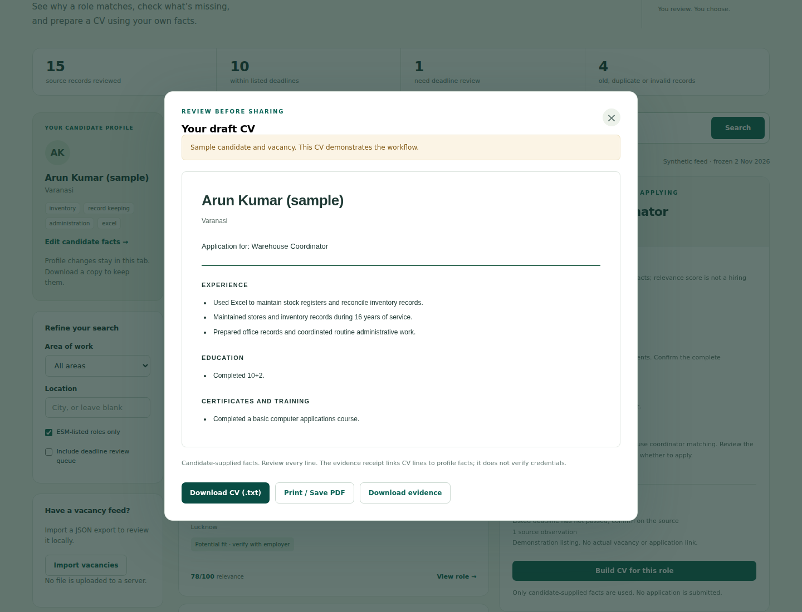

# Live validation — 2 November 2026

The original release ran browser automation on localhost and checked the public deployment hashes. That was not a full interaction test on the public URL. This follow-up adds distinct public-site, actual internet-transport and real-model checks.

**Passing workflow:** [SevaSetu live verification, run 2](https://github.com/kaulastudies/ai-evaluation-lab/actions/runs/41445792457). Tested adapter/test revision: `5c50896d6481e359ff2569ad1aa55d907c52e5ad`. The public-site report records deployed source `124d22d0ffd448c3c9eeac342e361a2fec0161b9`.

| Check | Observed result | Evidence |
| --- | --- | --- |
| Public HTTPS site | Desktop/mobile flow passed: profiles, filters, review queue, local vacancy import, CV and receipt downloads, exact downloaded-CV hash. No page errors or horizontal mobile overflow observed. | [Public browser report](live-2026-11-02/public-browser.json); screenshots and printed PDF in the workflow artifact |
| Actual internet ingestion | The production fetcher made a real HTTPS request with public DNS pinning. The synthetic fixture yielded 13 qualified jobs and one deliberately rejected control; timestamps and synthetic labels survived a roundtrip. Elapsed time 170 ms on this runner. | [Internet report](live-2026-11-02/internet-ingestion.json) |
| Actual local AI | Ollama 0.40.13, Qwen2.5 0.5B, CPU. Three synthetic candidate selections passed, preserving only supported claims. Observed case times: 1,880 / 875 / 714 ms; these are single observations, not latency percentiles. | [Model report and digest](live-2026-11-02/local-model.json) |
| Connected Chrome | The public page loaded; CV preview, sample-profile switch, filters, review queue and five interactive fixture checks were exercised through the connected browser. | Public-URL automation above provides reproducible download and mobile evidence |

## Failures found and resulting changes

The [initial live run](https://github.com/kaulastudies/ai-evaluation-lab/actions/runs/41445294649) is retained. The original model contract passed two of three cases; the IT case omitted an education fact and the validator correctly refused the output. See the unchanged [initial model report](live-2026-11-02/initial-model.json).

The fix removes education and licences from the model's decision entirely. The model chooses experience/achievement IDs only. The application always retains the qualifications and validates the complete claim set. An omission is not silently repaired and presented as a successful original model response: the contract was changed, then a new real run was measured.

The first public browser run completed the desktop interactions but crashed while creating the second browser context under a forced single-process setting. Normal browser process isolation fixed the test harness; no application success was inferred from that failed run.

The internet source example also exposed a compatibility gap: raw repository JSON uses `text/plain`. Explicit JSON sources now accept that type while retaining strict JSON parsing, exact host approval, public DNS checks/pinning, size limits and timeouts. HTML and binary bodies are not accepted as JSON sources. A contract test covers this boundary.

## Reproduce

Run the **SevaSetu live verification** workflow in GitHub Actions, or run `scripts/live-ingestion-check.mjs`, `tests/browser-check.mjs` with `SEVASETU_BASE_URL=https://aievaluationlab.tech/sevasetu/`, and `scripts/live-model-check.mjs` with an installed `qwen2.5:0.5b` model and a loopback Ollama server. The workflow pins and verifies the official Ollama archive and records the pulled model's digest.

Results are author-run engineering observations. The network payload and candidate records are synthetic. These checks do not establish official AWPO integration, current real vacancies, candidate credential truth, placement outcomes, broad model reliability or a user study. No email or job application was sent.
