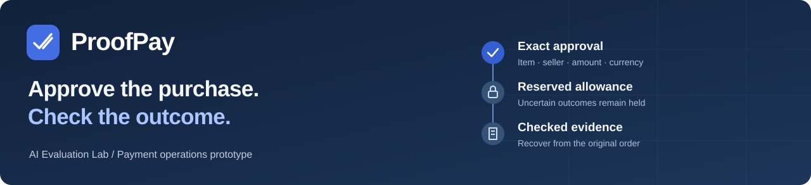
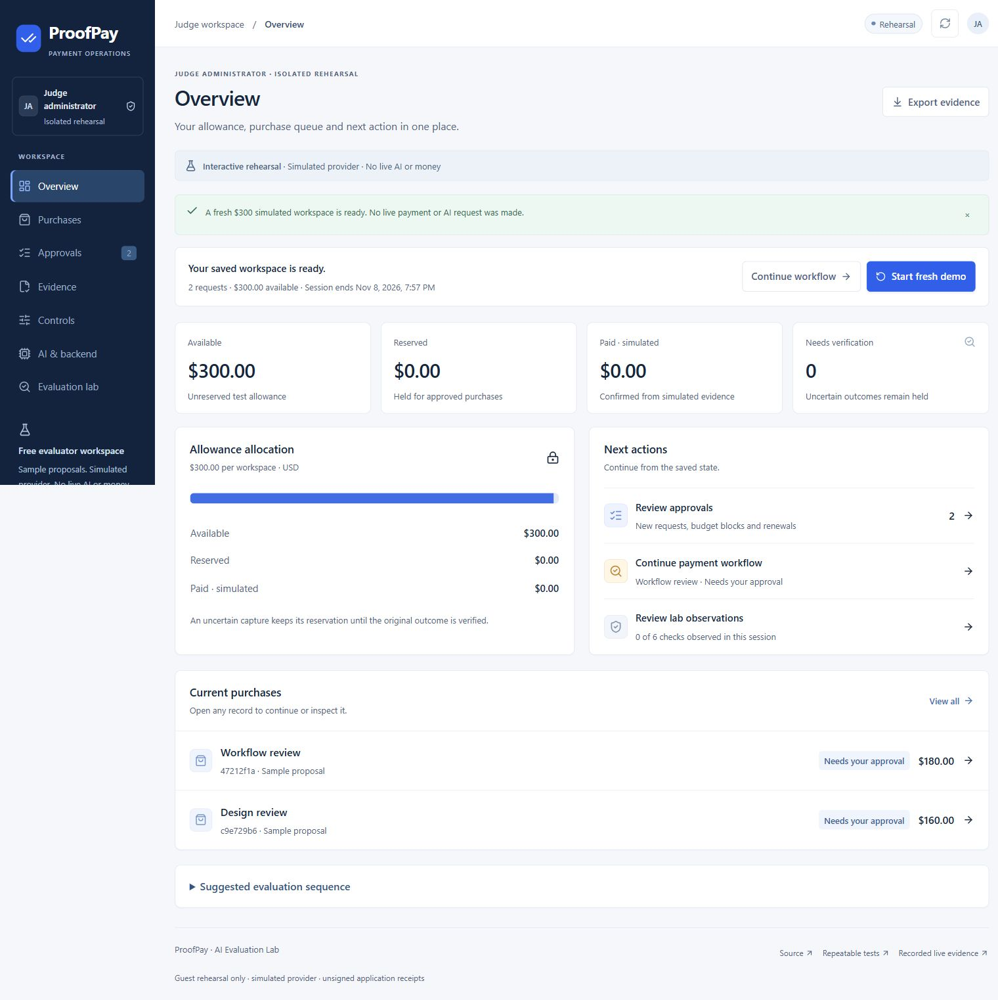
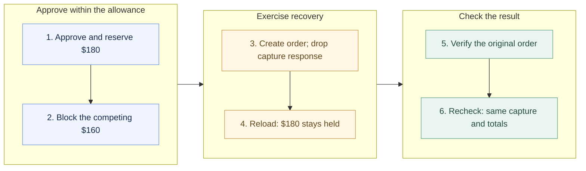
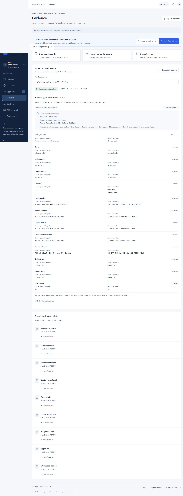

# ProofPay

[](https://proofpay-evaluation-lab.vercel.app)

**Owner-approved AI purchases with a shared allowance and a checkable payment outcome.**

[Open the judge workspace](https://proofpay-evaluation-lab.vercel.app) · **[Watch the 2:21 demo](https://youtu.be/D4UXBT-FhcE)** · [Try the workflow](#try-the-workflow) · [Inspect the evidence](#what-has-been-checked) · [Build locally](#build-and-explore)

An agent can suggest a purchase. The harder problem is keeping that suggestion tied to permission, available allowance and the outcome of a payment. ProofPay reserves allowance before dispatch and keeps it held when a capture response disappears. Recovery checks the original order before recording payment.

Built by [AI Evaluation Lab](https://github.com/kaulastudies/ai-evaluation-lab) for the [PayPal AI Hackathon](https://paypalaihackathon.devpost.com/), the prototype gives agencies, consultancies and studios a purchase desk they can inspect—from the original request to its saved receipt.

[](https://proofpay-evaluation-lab.vercel.app)

*Actual public portal capture. These requests and payment outcomes are simulated.*

## Try the workflow

[Open the public workspace](https://proofpay-evaluation-lab.vercel.app), then choose **Open judge workspace**. No account, owner key, PayPal login or API credentials are needed. The free rehearsal gives each visitor a separate, temporary workspace.

Two sample requests cost $180 and $160 against a $300 allowance. Follow the sequence below, using **Continue workflow** to reach the next action. Returning to a completed session? Choose **Start fresh demo → Confirm fresh demo**.



The seven sections cover **Overview, Purchases, Approvals, Evidence, Controls, AI & backend, and Evaluation lab**. Create sample requests, renew expired approvals, cancel untouched requests, compare stored receipt fields and export the records—all inside the portal.

The public rehearsal makes **no live AI or PayPal calls**. A separate [recorded owner run](evidence/configured-live-qa-2026-11-08.md) contains an actual `openai/gpt-4.1-mini` proposal through Vercel AI Gateway and a $180 PayPal sandbox purchase, including response-loss recovery. That run used virtual funds; its one-attempt model grant is consumed.

## What has been checked

These are dated project results from **8 November 2026**, with different source and execution scopes.

| Evidence | Recorded result | Revision and scope |
|---|---|---|
| [Local release checks](evidence/judge-portal-source-qa-2026-11-08.json) | **210/210 passed**; types, lint and build passed | Source hashes match `26893ed6`; reviewed on base `5e4192b`. |
| [Deployed PostgreSQL checks](evidence/judge-portal-browser-qa-2026-11-08.json) | **9/9 passed**, no skips; migrations passed | Deployment of `cfd1d007`. |
| [Browser recovery workflow](evidence/judge-portal-browser-qa-2026-11-08.json) | **6/6 observations** completed | Simulated guest workflow at `cfd1d007`. |
| [Responsive portal review](evidence/judge-portal-browser-qa-2026-11-08.json) | **21 layouts**, no horizontal overflow | Seven views × 360/768/1280px at `26893ed6`; the later revision changes selection priority only. |

These results do not establish production readiness or an independent audit certificate. [Repeatable commands and measurement limits](docs/REPEATABLE_TESTING.md) explain what each check covers.

<details>
<summary><strong>Open the actual Evidence screen</strong></summary>



The inspector distinguishes current approval values, stored observations and fields not recorded by the receipt schema. Screenshots are interface evidence; they do not authenticate a provider response.

</details>

## Scope and next steps

Today: one controlled sample seller, USD, owner approval and simulated or PayPal sandbox outcomes. No production payments, refunds, fulfillment or multiuser administration. Receipts are unsigned application records; historical approval-version and catalogue-item gaps remain documented. Browser-exported file bytes are not yet verified.

Next: strengthen receipt provenance, broaden recovery evidence and validate the business pilot with service-buying teams. See the [provenance roadmap](docs/PROVENANCE_ROADMAP.md) and [pilot plan](docs/COMMERCIAL_PLAN.md); customer traction and pricing remain unvalidated.

## Project credits

| Name | Project role |
|---|---|
| **Rama Chandra Malayanur** | Founder and Principal Researcher, AI Evaluation Lab |
| **Prof. Nithya** | Principal Advisor for ProofPay |

## Build and explore

[Project report](docs/PROJECT_REPORT.md) · [Judge guide](docs/JUDGES.md) · [Development](docs/DEVELOPMENT.md) · [Architecture](docs/ARCHITECTURE.md) · [Security review](docs/SECURITY_REVIEW.md) · [API collection](postman/README.md) · [Demo reproduction](tools/demo-video-v2/README.md)

<details>
<summary><strong>Install, test and run locally</strong></summary>

The current stack is **Next.js 16, React 19, Node.js 24, Vercel and Neon/PostgreSQL**. Use Node.js 24.x:

```sh
git clone --branch proofpay/purchase-desk-v0.1 https://github.com/kaulastudies/ai-evaluation-lab.git
cd ai-evaluation-lab/hackathon/proofpay
npm run install:ci
npx tsc --noEmit
npm run lint
npm test
npm run build
node tests/responsive/build.mjs
```

These local checks do not call a model or PayPal. The live PostgreSQL gate needs a separately configured test connection. [Development setup](docs/DEVELOPMENT.md) covers isolated schemas, migrations, owner-key configuration and Vercel release checks.

Judges need none of this setup. To run a private owner instance, supply a dedicated database and server variables through an uncommitted `.env.local`, then apply migrations and start HTTPS development:

```sh
node --env-file=.env.local scripts/migrate-postgres.mjs
npm run dev -- --experimental-https
```

Set `APP_ORIGIN=https://localhost:3000` and use the printed HTTPS address. The protected owner deployment is separate from public judge access. There is no simulated owner login or local-ledger fallback; retired Sites/Worker/D1 instructions do not apply.

</details>

<details>
<summary><strong>Guest isolation, usage limits and runtime modes</strong></summary>

| Mode | Selection and payment path | Access |
|---|---|---|
| Public judge rehearsal | Deterministic sample rules; durable simulated provider | Temporary guest session; no owner or provider credentials |
| Private owner rehearsal | Simulated purchase controls | Owner session and remote database |
| Owner AI + PayPal sandbox | Validated model proposal, owner approval, native buyer approval, verified provider fields | Owner/database, PayPal sandbox and the reviewed free-credit policy |
| Owner PayPal diagnostic | Fixed $180 proposal; no AI model | Owner/database and PayPal sandbox; starting does not dispatch payment |

The public project has a dedicated database and session secret. Owner APIs and sign-in are disabled there. Guest sessions use signed Secure/HttpOnly/SameSite=Strict cookies lasting two hours. Limits are **100 mutations and 10 additional resets per session**, with at most **60 new sessions per hour and 300 total** for the deployment. Availability is bounded; the demo is not an unlimited service.

The private owner desk also has versioned business settings, immutable workspace snapshots, owned history selection and a formula-protected CSV report. Department names are reporting labels, not roles or separate budgets. Guest resets affect only simulated workspaces and never reset the consumed live-model grant.

The [earlier independent HTTPS review](evidence/judge-hosted-qa-2026-11-08.json) records 21 expected outcomes, including two-guest isolation and denied owner/sandbox/cross-origin actions. Those are separate from the 21 responsive layouts above. Earlier owner checks and the dated [zero-finding dependency audit](evidence/dependency-remediation-2026-11-08-summary.json) retain their original scope.

</details>

<details>
<summary><strong>Inspect receipts and reproduce the demonstration</strong></summary>

Open **Evidence** in the app to compare stored fields or export simulated JSON receipts. A version 1 receipt can also be checked offline:

```sh
node scripts/verify-receipt.mjs /path/to/receipt.json
```

The [HTTPS review](evidence/judge-hosted-qa-2026-11-08.json) downloaded a 4,254-byte guest receipt from the API and passed this verifier. That result covers API bytes, not the browser’s Blob export or owner CSV download. A verifier pass means the unsigned record is internally consistent; it does not prove provider authenticity, current spending authority or TIP compatibility.

The [Postman collection](postman/README.md) covers owner login/logout, proposals, approvals, cancellation, renewal and evidence. It contains no credentials and defaults to rehearsal. Its schema and scripts were checked offline; actual Postman execution is not claimed.

The [V2 demonstration source](tools/demo-video-v2/README.md) combines actual captured UI states with local Kokoro narration, without an avatar or paid speech service. It is an edited walkthrough, not continuous footage of the original external transaction. [Narration and verification boundaries](docs/DEMO_SCRIPT.md) retain the reproduction details. No new live model or PayPal call was made to produce it.

</details>

[Apache-2.0](LICENSE). Preserve dependency and starter notices. PayPal product names identify the integration and do not imply endorsement.
