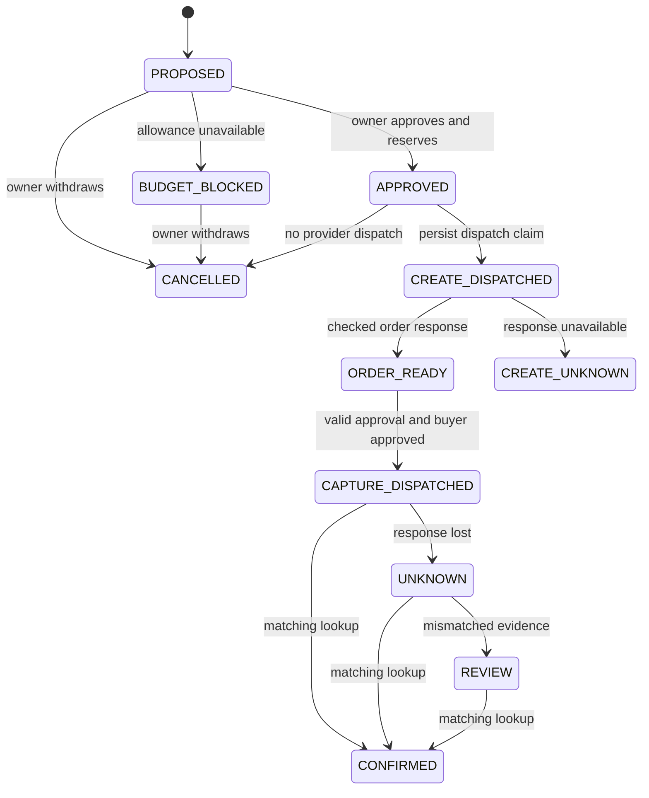

# Architecture and limits

The current source targets native Next.js 16 on Node.js 24, deployed through GitHub and Vercel, with financial state in remote Neon/PostgreSQL. The earlier Sites/Worker/D1 deployment is retired as a delivery path; its recorded sandbox results remain historical evidence. The migrated hosted workflow is not yet verified.

ProofPay stores business intent and financial state on the server. The browser displays that state and requests actions. It cannot set catalogue prices, approve a PayPal buyer session or write a confirmed payment directly.

## Responsibility boundaries

| Layer | Responsibility |
|---|---|
| `components/proofpay/purchase-desk.tsx` | Owner interface, mode labels, allowed actions and evidence inspection. |
| `lib/proofpay/auth.ts`, `login.ts` | Salted owner-key verification, signed eight-hour session cookie, exact-origin JSON mutations and durable login throttling. |
| `lib/proofpay/ai.ts`, `ai-funding.ts` | One permitted SKU/rationale through the fixed Vercel free-credit path; deterministic rehearsal stays separate. |
| `lib/proofpay/service.ts` | Owner isolation, immutable approval digest, atomic reservation, durable dispatch claims and reconciliation. |
| `lib/proofpay/provider.ts` | Sandbox-only PayPal API adapter, independently checked provider identity and durable simulated provider. |
| `lib/proofpay/postgres-database.ts`, `runtime.ts`, `db/postgres/` | Remote PostgreSQL, bound statements, serializable batches and versioned migrations; no local ledger fallback. |

## Operation states

The diagram omits repeated reads and errors that leave state unchanged. All approved, dispatched, unknown and review states retain a reservation. A confirmed operation contributes to committed spend instead. A blocked or cancelled proposal contributes to neither.

## Concurrency and recovery

Approval uses a conditional SQL `UPDATE` whose predicate includes held operations in the workspace. PostgreSQL executes the reservation/audit batch at serializable isolation. The adapter retries only explicit serialization/deadlock aborts after successful rollback, up to three retries; it does not retry ambiguous transport/commit failures or external provider work. The former SQLite concurrency results are historical domain evidence; the migrated PostgreSQL behavior needs its own validation. The budget is a $300 demonstration allowance per isolated workspace, not a bank balance or an account-wide spending control.

Create and capture have separate persisted request IDs. Compare-and-set transitions claim dispatch before a provider call. A second capture request cannot acquire an already dispatched operation. Recovery only reads the original order; it does not create a replacement order or retry capture. Provider idempotency remains an additional, time-limited provider feature, not an indefinite guarantee.

The fault control discards a completed capture response before application confirmation. It is an application fault injection, not a claim that PayPal malfunctioned. Rehearsal stores the simulated provider effect in the database so a fresh service process can inspect it after restart.

Confirmation requires the expected order ID, operation references, merchant, amount, currency, a completed order and a single completed final capture. A refund or contradictory result requires review. Repeated matching reconciliation cannot add another accounting transition. The schema also makes order and capture IDs unique.

## Approval and access

Owner approval binds operation, workspace, item, price, currency, merchant, mode, version and expiry in a SHA-256 digest. It expires after 15 minutes. Expiry prevents a new dispatch; it does not release funds whose outcome may already exist. Native PayPal buyer approval is a separate step. Explicit renewal is allowed only for an expired `APPROVED` or `ORDER_READY` operation in the active workspace. It preserves purchase, reservation and provider IDs; version, digest, expiry and the consent event change atomically. Dispatch compares the version/digest/expiry it actually checked, preventing an old request from using renewed authority. Renewal neither extends PayPal order lifetime nor releases reserved funds.

Cancellation accepts the owner, active workspace, exact approval version and an untouched `PROPOSED`, `BUDGET_BLOCKED` or `APPROVED` state with no provider order/capture. For an approved request the stored digest must still match, even if its authority has expired. The event and conditional transition to `CANCELLED` share a transaction. Their predicate includes the observed status, version, digest and expiry: concurrent approval, renewal or dispatch cannot silently release funds. An identical cancellation is idempotent. Request and purchase identities stay intact. No provider call is made.

The current runtime accepts only a valid signed owner session, issued after verification of a salted scrypt owner-key hash. Sites/Vercel identity headers do not grant access. The `__Host-proofpay-session` cookie is Secure, HttpOnly, SameSite=Strict, host-only and valid for eight hours. Mutations must match the configured `APP_ORIGIN` and use JSON. A durable global login counter permits at most ten attempts per minute. Logout clears this client cookie; it is not server-side revocation of copied tokens. There is no mock-login route. Missing owner or database configuration fails closed.

## Free-credit inference boundary

The selected model path is Vercel AI Gateway with runtime OIDC and fixed `openai/gpt-4.1-mini`. Personal OpenAI/API keys and arbitrary endpoints/models are rejected. A reviewed grant reference, expiry, free-only declaration and total attempt limit are required. The chosen total is one; code allows an explicitly configured value from one to ten. Each workspace can consume one dispatched attempt, and a durable grant ledger spans workspaces. The attempt and audit row commit before inference. Failures, timeouts and invalid output are not refunded or retried. A successful same-key repeat reads the stored proposal.

The adapter caps input at 2,000 characters and output at 400 tokens, with no provider/model fallback. These are request limits backed by an operator-reviewed free-credit declaration; they do not independently inspect or guarantee provider billing. Actual eligibility, credit use and model execution remain separate evidence.

## Deliberate limits

- Real model calls and actual PayPal sandbox runs must be verified separately from local tests and rehearsal.
- A lost create response without a saved provider order ID requires manual review. There is no blind create retry or request-ID search endpoint in this prototype.
- No cancellation after provider dispatch, automatic reservation expiry, webhook receiver, refunds, fulfillment, subscriptions or production payments.
- Starting a new rehearsal creates a separate demonstration allowance. An active sandbox workspace with held operations cannot be hidden by switching workspaces.
- The event log aids inspection; it is not a signed, externally anchored or tamper-proof audit system. Database compromise is outside the tested protection boundary.
- No general exactly-once, fraud prevention, regulatory compliance or production-readiness claim follows from the tested cases.
