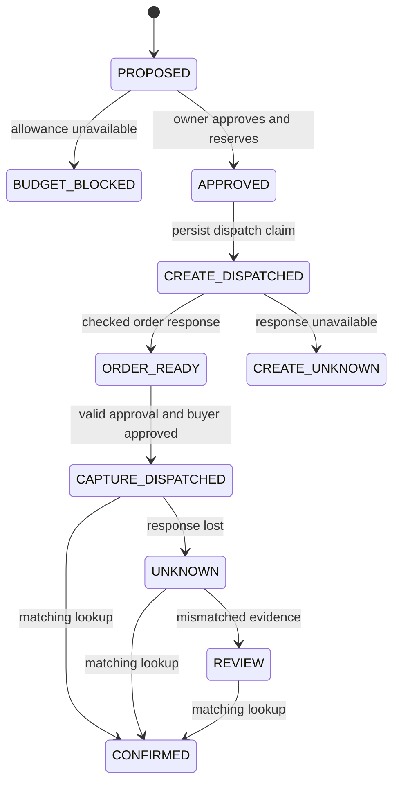

# Architecture and limits

ProofPay stores business intent and financial state in D1. The browser displays that state and requests actions. It cannot set catalogue prices, approve a PayPal buyer session or write a confirmed payment directly.

## Responsibility boundaries

| Layer | Responsibility |
|---|---|
| `components/proofpay/purchase-desk.tsx` | Owner interface, mode labels, allowed actions and evidence inspection. |
| `lib/proofpay/auth.ts` | Require the trusted ingress identity and same-origin JSON mutations. |
| `lib/proofpay/ai.ts` | Interpret requests into a permitted SKU and rationale; deterministic selection only in explicitly separate rehearsal mode. |
| `lib/proofpay/service.ts` | Owner isolation, immutable approval digest, atomic reservation, durable dispatch claims and reconciliation. |
| `lib/proofpay/provider.ts` | Sandbox-only PayPal API adapter, independently checked provider identity and durable simulated provider. |
| `db/schema.ts`, `drizzle/` | Persist workspaces, active sessions, operations, events and simulated provider orders. |

## Operation states

The diagram omits repeated reads and errors that leave state unchanged. All approved, dispatched, unknown and review states retain a reservation. A confirmed operation contributes to committed spend instead. A blocked proposal contributes to neither.

## Concurrency and recovery

Approval uses a single SQLite `UPDATE` whose predicate includes the sum of held operations in the workspace. It checks and reserves within the same write. Two requests cannot both reserve against an earlier application-level balance. The budget is a $300 demonstration allowance per isolated workspace, not a bank balance or an account-wide spending control.

Create and capture have separate persisted request IDs. Compare-and-set transitions claim dispatch before a provider call. A second capture request cannot acquire an already dispatched operation. Recovery only reads the original order; it does not create a replacement order or retry capture. Provider idempotency remains an additional, time-limited provider feature, not an indefinite guarantee.

The fault control discards a completed capture response before application confirmation. It is an application fault injection, not a claim that PayPal malfunctioned. Rehearsal stores the simulated provider effect in the database so a fresh service process can inspect it after restart.

Confirmation requires the expected order ID, operation references, merchant, amount, currency, a completed order and a single completed final capture. A refund or contradictory result requires review. Repeated matching reconciliation cannot add another accounting transition. The schema also makes order and capture IDs unique.

## Approval and access

Owner approval binds operation, workspace, item, price, currency, merchant, mode, version and expiry in a SHA-256 digest. It expires after 15 minutes. Expiry prevents a new dispatch; it does not release funds whose outcome may already exist. Native PayPal buyer approval is a separate step. Explicit renewal is allowed only for an expired `APPROVED` or `ORDER_READY` operation in the active workspace. It preserves purchase, reservation and provider IDs; version, digest, expiry and the consent event change atomically. Dispatch compares the version/digest/expiry it actually checked, preventing an old request from using renewed authority. Renewal neither extends PayPal order lifetime nor releases reserved funds.

Hosted identity relies on the Sites ingress setting `oai-authenticated-user-id`. Do not expose the Worker behind an ingress that trusts arbitrary client-supplied identity headers. Local development uses the starter's loopback-only simulated sign-in; that is not production authentication.

## Deliberate limits

- Real model calls and actual PayPal sandbox runs must be verified separately from local tests and rehearsal.
- A lost create response without a saved provider order ID requires manual review. There is no blind create retry or request-ID search endpoint in this prototype.
- No approval revocation or reservation release, automatic reservation expiry, webhook receiver, refunds, fulfillment, subscriptions or production payments.
- Starting a new rehearsal creates a separate demonstration allowance. An active sandbox workspace with held operations cannot be hidden by switching workspaces.
- The event log aids inspection; it is not a signed, externally anchored or tamper-proof audit system. Database compromise is outside the tested protection boundary.
- No general exactly-once, fraud prevention, regulatory compliance or production-readiness claim follows from the tested cases.
