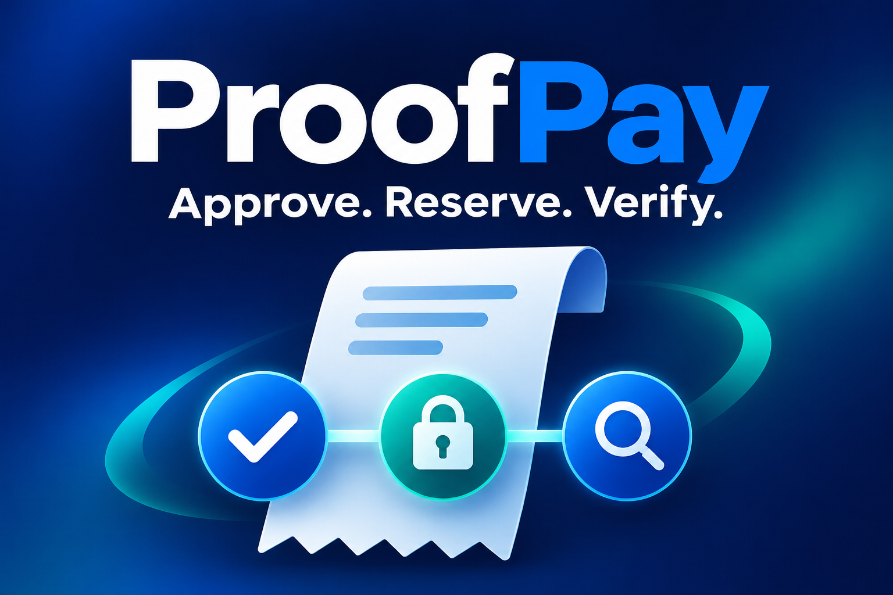
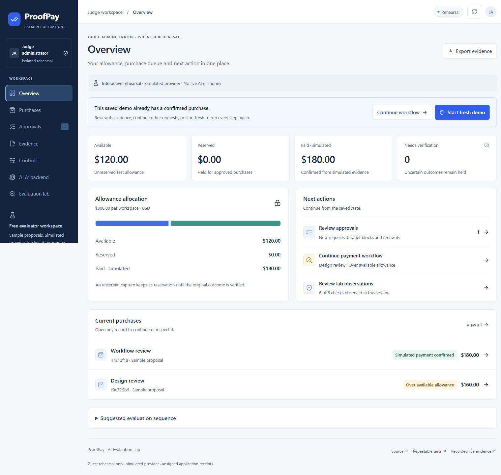
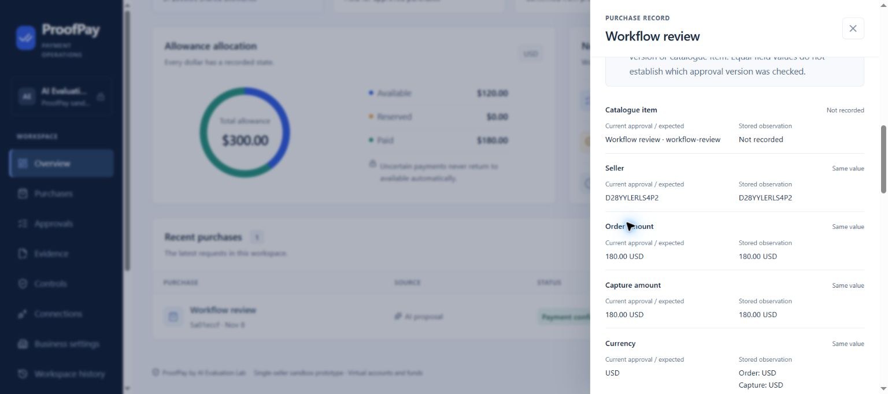

# ProofPay Devpost submission record

**Submitted to the PayPal AI Hackathon on 8 November 2026.** [Open the public project](https://devpost.com/software/proofpay-purchase-desk). After the owner confirmed all team declarations and terms, the release owner checked the final terms box and clicked Submit project once. Devpost displayed “Project submitted!” and “SUBMITTED TO PayPal AI Hackathon,” with an Edit hackathon submission link.

The current **8,785-character Story** below was saved and reopened with an exact source match: SHA-256 `318cb9b2f6512b22237294fe4c942b59b1a138a391e4493caf22e1e04a127f36`. The earlier 7,531-character and 7,676-character saves are historical checkpoints. Both exact team credits, canonical demo/source links, the public YouTube video and the testing/AI-tool disclosures remain part of the entry.

Three standard Markdown images loaded in the Story: the AI-generated marketing cover (1536×1024), the actual rehearsal overview (1520×1443), and the saved sandbox receipt (1536×682). The cover is an illustration, not a product screenshot. Native image-file uploads failed or timed out: the native project-card thumbnail remains a placeholder and the native gallery is empty. This record confirms inline images, not native thumbnail/gallery uploads.

## Project name

ProofPay Purchase Desk

## Short pitch

Approve a purchase, reserve its allowance and check what happened when the payment response disappears.

## Story

### Inspiration

A payment timeout leaves a practical question: did the purchase fail, or did only the response disappear?

We built ProofPay around a small studio with a $300 allowance for outside review work. Two requests cost $180 and $160. Both may be useful, but they cannot both fit. The owner needs to approve the exact purchase, see what remains available and inspect the payment outcome when a response goes missing.

### What it does

ProofPay connects a purchase request, owner approval, allowance reservation and checked provider outcome in one operation.

A model proposes an item from a controlled catalogue and explains its choice. Server code determines the seller, price and currency; the model cannot approve a purchase or declare payment complete. Owner approval reserves allowance before dispatch. PayPal's native buyer approval is a separate step.

If a capture response disappears, the purchase remains unresolved and its allowance stays reserved. Recovery reads the original order and checks the operation, seller, amount, currency and completed final capture before recording payment. A receipt inspector makes those stored comparisons readable and shows where information is missing.

Owners can renew expired approval for an unchanged purchase before capture dispatch, or cancel an untouched request before any provider dispatch. The allowance belongs to a workspace, not the owner's entire PayPal account.

The catalogue contains three synthetic digital-service packages: Workflow review ($180), Design review ($160) and Starter review ($90). No paid review service is delivered. The sandbox uses virtual funds.

### Judge experience

Open **https://proofpay-evaluation-lab.vercel.app** and choose **Open judge workspace**. No login or payment credentials are required; each visitor receives an isolated, temporary rehearsal session. The complete workflow has been verified in the expanded public portal.

The expanded portal organizes **Overview, Purchases, Approvals, Evidence, Controls, AI & backend and Evaluation lab**. Judges can approve a $180 request, see the competing $160 request blocked, simulate a missing capture response, reload and recover the original outcome. Evidence keeps the purchase record and receipt inspector in the app. AI & backend is read-only; Evaluation lab tracks six observations for the current session.

This free workspace uses sample proposals and simulated payments with the application's approval, reservation and recovery logic. It never calls the model or PayPal and cannot spend provider credits. Saved external-run evidence is separate from each judge's rehearsal. [Repeatable testing instructions](https://github.com/kaulastudies/ai-evaluation-lab/blob/proofpay/purchase-desk-v0.1/hackathon/proofpay/docs/REPEATABLE_TESTING.md) explain the session and usage limits.

### Workflow screens

**Public judge portal after recovery.** This is the free rehearsal with simulated payments: $120 available, $0 reserved and $180 simulated paid.

**Saved PayPal sandbox evidence.** This screen comes from the completed GPT-4.1-mini and PayPal sandbox run using virtual funds. The receipt inspector shows the stored comparisons and missing historical catalogue evidence. It is an unsigned application record, not a new transaction.

### How we built it

The application uses TypeScript, Next.js 16 and React 19 on Node.js 24, deployed through GitHub and Vercel with Neon/PostgreSQL. Owner sessions use signed cookies. Approval binds the exact purchase and expiry; a conditional database transaction reserves the allowance. Create and capture request IDs are stored before provider dispatch.

PayPal OAuth and Orders v2 handle order creation, native buyer approval, capture and lookup. Confirmation and its limited verification snapshot are persisted together. The public judge deployment uses separate rehearsal storage and disables owner routes.

The runtime model route uses Vercel AI Gateway with a reviewed free-credit grant and a durable attempt limit. Failed attempts count; the application does not silently retry or switch to personal provider credentials. The grant's one model attempt has been consumed. We preserve that completed proposal instead of making another model call for a demonstration.

### What we verified

On 8 November, the deployed owner application completed a genuine model-to-PayPal sandbox purchase. Gateway evidence records `openai/gpt-4.1-mini`, HTTP200, 242 input tokens and 48 output tokens, with a displayed USD0.0002 request cost. It used the reviewed Vercel free-credit route, with no personal OpenAI key or personal credits.

That proposal became a $180 purchase. The owner approved it, the sandbox buyer completed PayPal's native approval, and the application dispatched capture while deliberately dropping the response. A browser reload retained $180 reserved, $120 available and $0 paid.

A GET of the original order confirmed the matching completed final capture. The result became $180 paid, $0 reserved and $120 available. Repeated lookup retained the same capture and totals. This is one observed sandbox run; aggregate external request counts were not independently measured.

The seven-section source checkpoint `26893ed6` passed **210 local tests, TypeScript, full lint and build**. The current `cfd1d007` deployment passed **nine real PostgreSQL checks with no skips**, committed migrations, TypeScript and the Next.js build; both CI workflows passed. These checks are not live model or payment calls.

The [new browser review](https://github.com/kaulastudies/ai-evaluation-lab/blob/proofpay/purchase-desk-v0.1/hackathon/proofpay/evidence/judge-portal-browser-qa-2026-11-08.json) completed the six-step rehearsal at `cfd1d007`: approve $180, block $160, lose the simulated response, reload with the reservation intact, confirm the original order and check again without changing the result. Overview reopened the same unresolved purchase; Evidence displayed its matching references and recorded limits. Evaluation lab showed **6/6 observed**, and the captured application console was empty.

All seven views were checked at 360, 768 and 1280 pixels: **21 responsive views**, with no horizontal overflow and 16px main text. Those measurements were taken at `26893ed6`; the later `cfd1d007` change affects the preferred workflow selection, not the layout.

Separately, the earlier release passed **21 independent HTTPS checks across two guest sessions**, including isolation and recovery. An actual guest receipt downloaded over HTTPS passed the offline consistency verifier. Those HTTP results remain dated evidence; they are a different set of checks from the new 21 responsive views.

The earlier owner browser CSV/Blob download remains unverified. The successful guest HTTPS receipt check does not replace that missing evidence.

### What we learned

An application decision and an external payment effect need different evidence. A missing response cannot justify releasing allowance or issuing another purchase. A model's explanation, a return link and a completed provider capture are not interchangeable.

The receipt is useful for inspection, but it is unsigned application evidence. Its provider verification snapshot lacks the historical approval version and catalogue SKU. Matching current fields and passing the offline verifier establish limited internal consistency, not provider authenticity, historical authority or service fulfillment.

### What's next

The next commercial test is whether owner-led agencies, consultancies or studios will pay for a reusable approval, allowance and recovery workflow. Customer demand, time savings and pricing remain hypotheses.

The current build covers one controlled seller, US dollars and a workspace allowance. Production payments, refunds, webhooks, fulfillment, multi-user roles and provider portability remain outside this build. Our immediate focus is learning from repeatable evaluations before expanding that scope.

### Team credits

Rama Chandra M — Founder and Principal Researcher, AI Evaluation Lab

Prof Nithya Ravi Kumar — Principal Advisor for ProofPay

## Video and submission references

- [Public judge workspace — no login](https://proofpay-evaluation-lab.vercel.app)
- [Public source and setup](https://github.com/kaulastudies/ai-evaluation-lab/tree/proofpay/purchase-desk-v0.1/hackathon/proofpay)
- [Watch the public V2 video](https://youtu.be/D4UXBT-FhcE) — published 8 November 2026; watch-page playback verified at a displayed 2:21.
- [Actual AI-to-PayPal run](../evidence/configured-live-qa-2026-11-08.md) · [seven-section browser review](../evidence/judge-portal-browser-qa-2026-11-08.json) · [local source checks](../evidence/judge-portal-source-qa-2026-11-08.json) · [repeatable testing](REPEATABLE_TESTING.md)
- [Architecture](ARCHITECTURE.md) · [judge readiness](JUDGE_READINESS.md) · [exact narration and scenes](DEMO_SCRIPT.md)

The frozen V2 video follows one purchase from approval and allowance reservation through a missing response to recovery. Its 29 timed shots use actual captured application states; scene six is clearly labelled saved evidence from the completed external run. This is an edited walkthrough, not a continuous recording of that original transaction. The video is **141.354362 seconds**, with **43 captions preserving all 312 narration words**. Kokoro `af_heart` speech was generated locally without API or provider credits; V2 uses no avatar. Full decode passed, decoded audio peaked at −1.969 dBFS with zero clipped samples, and sampled visual review found the reviewed scenes readable. No independent listening or forced-alignment result is claimed. The film is public at the link above. Its 43 burned-in captions are present; the exact native transcript was saved for YouTube automatic timing, while public selectable captions were unavailable at the first watch-page check and remain processing. Native caption timing is not yet quality-checked. The rejected 163.521-second Flite cut is not the submission video.

The YouTube description was also saved with **Rama Chandra M** and **Prof Nithya Ravi Kumar**; the disabled Save button confirmed the saved state. This changes publication credits, not the frozen video or its narration.

Implemented technology tags: TypeScript, Next.js, React, Node.js, Vercel, Neon, PostgreSQL, Vercel AI Gateway, OpenAI GPT-4.1 mini, PayPal REST APIs, PayPal Orders v2. The Postman collection is authored and checked offline; actual Postman execution is not claimed. Do not list Toolkit, MCP or agent-commerce protocols as implemented integrations without corresponding evidence.

The application was added during the event within the existing AI Evaluation Lab repository. Preserve the starter and dependency notices. Prof Nithya Ravi Kumar's Devpost team acceptance was confirmed; team membership does not create an application role or establish a particular contribution.

## Submission status and remaining checks

| Item | Current state |
|---|---|
| Meaningful runtime AI and PayPal sandbox | Verified once in the same hosted workflow. Model/order/capture evidence retained; the reviewed model grant is consumed. |
| Independent judge access | Seven-section public portal verified: complete six-observation workflow, current receipt inspection, 21 responsive views and an empty captured application console. Earlier two-guest HTTP isolation evidence retains its separate scope. |
| Public YouTube video | [Published V2](https://youtu.be/D4UXBT-FhcE): Studio confirmed Published/Public on 8 November; watch-page playback displayed 2:21. The frozen source file is 141.354362 seconds. Burned-in captions are present; native selectable captions are still processing. Old Flite cut rejected. |
| Video/source consistency | The finished V2 preserves the exact 312-word narration, states 210 local checks and separates saved external-run evidence from a fresh simulation. Sampled visual review passed; no independent listening or forced-alignment claim. |
| Receipt export | Actual guest HTTPS receipt download and offline consistency check passed. Owner browser CSV/Blob file bytes remain unverified. |
| Saved entry | The complete 8,785-character visual Story was saved and reopened with an exact source match. Both team credits and all three inline images were confirmed; canonical demo/source and video links remain saved. Native card/gallery uploads did not succeed. |
| Final Devpost submission | **Submitted.** The owner confirmed eligibility and rules assent; the release owner clicked Submit project once and observed the success message and submitted sidebar at the public project URL. |

The [official requirements](https://paypalaihackathon.devpost.com/) and [rules](https://paypalaihackathon.devpost.com/rules), reviewed 8 November 2026, require meaningful PayPal/AI use, runnable access, public licensed source and a public YouTube demonstration under three minutes. No prize, production-readiness or general exactly-once claim is made.
