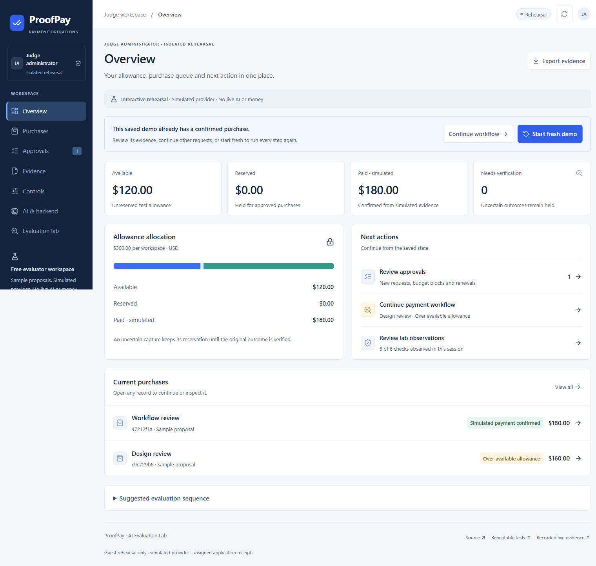
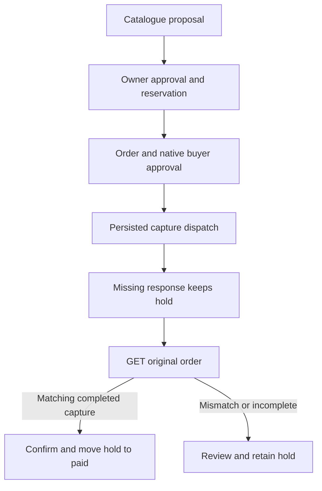

# ProofPay Project Report

Project outcomes and next development priorities

8 November 2026

Rama Chandra Malayanur — Founder and Principal Researcher, AI Evaluation Lab

Prof. Nithya — Principal Advisor for ProofPay

## Executive outcome

ProofPay is a working purchase approval and payment evidence prototype for small service businesses. It connects an approved request, its share of a workspace allowance and the outcome of the original payment. When a capture response is missing, the application keeps the allowance reserved until the original order can be checked. This gives an operator a specific next action without treating an unknown outcome as a failed payment.

The project completed one genuine GPT-4.1-mini proposal and PayPal sandbox purchase using $180 in virtual funds. A separate public portal lets judges try the supported workflow without signing in or consuming model credits. Its seven sections cover Overview, Purchases, Approvals, Evidence, Controls, AI and backend, and Evaluation lab. The public experience uses simulated payments and does not expose the protected owner account. [1–3]

The delivered work includes server-side approval and reservation controls, durable payment request identities, original-order recovery, inspectable receipts, business settings and history, public licensed source, and a 2 minute 21 second narrated demonstration. The next product decision is whether this workflow saves a real customer enough investigation or integration effort to justify a scoped pilot. Production money movement and commercial adoption remain future work.

Figure 1  Actual public portal after recovery with $120 available, $0 reserved and $180 simulated paid. This capture is a rehearsal result, not a real-money balance.

Public portal: https://proofpay-evaluation-lab.vercel.app

Public demonstration: https://youtu.be/D4UXBT-FhcE

<!-- PAGE -->

## The customer problem and purchase workflow

An owner-led agency, consultancy or studio may approve outside work while several requests compete for the same allowance. A missing payment response creates an additional problem: the provider may already have processed the purchase, even though the application has no confirmed result. Releasing the reservation or starting another payment would make the displayed allowance unreliable or introduce another operation to investigate.

ProofPay keeps that decision attached to one purchase. The model can recommend an item from a server-controlled catalogue, but it cannot approve or confirm a payment. The owner approves the exact request. PayPal buyer approval is a separate native provider step in the actual sandbox flow. The guest portal replaces both the proposal source and payment provider with clearly labelled simulation.

Figure 2  Simplified recovery path. A mismatched or incomplete lookup remains under review with the reservation held. The diagram omits cancellation, expiry and unchanged-error paths.

### The demonstrated allowance example

Starting with $300, approval of a $180 review reserves that amount and leaves $120 available. A competing $160 request is blocked. Deliberately discarding the capture response creates an uncertain outcome; reloading the page preserves the $180 hold. Looking up the original order confirms the matching completed capture. The desk then shows $180 paid, $0 reserved and $120 available. Repeating the lookup leaves the same capture reference and totals. [2]

This is an application fault injection. It does not claim that PayPal failed. A workspace allowance is a test planning limit, not a bank balance, deposit or account-wide spending control. The potential benefit is easier approval and investigation; customer time savings have not yet been measured.

<!-- PAGE -->

## Architecture and control boundaries

The current application uses Next.js 16 on Node.js 24, hosted on Vercel, with financial state in Neon PostgreSQL. The browser presents records and requests actions; the service owns catalogue values, approval checks, reservations, dispatch claims and reconciliation. Local fixtures remain useful regressions, while the deployed database gate checks PostgreSQL behavior separately. [3–5]

| Boundary | Implemented control | Practical meaning |
| --- | --- | --- |
| Purchase authority | Approval binds operation, workspace, item, amount, currency, merchant, mode, version and expiry in a SHA-256 digest. | A changed payment request cannot silently reuse the checked approval. The digest is not a digital signature. |
| Shared allowance | Conditional reservation and audit writes run transactionally; PostgreSQL batches use serializable isolation. | Overlapping approvals must respect the workspace allowance. Ambiguous commit failures are not blindly retried. |
| Payment dispatch | Create and capture use separate persisted request IDs and conditional dispatch claims. | A second request cannot simply acquire an operation already dispatched. Recovery reads the original order. |
| Confirmation | The lookup checks order and operation references, merchant, amount, currency, completed order and a single completed final capture. | Contradictory or incomplete evidence stays unresolved rather than becoming confirmed. |
| Access | Protected owner sessions, salted key verification, exact-origin JSON mutations and durable login throttling. Guest records are isolated. | Public rehearsal access does not grant owner authority, reveal credentials or enable external providers. |

### Approval lifecycle and business context

Approval expires after 15 minutes. Expiry prevents new dispatch but does not release an amount whose payment outcome may already exist. Explicit renewal is limited to eligible states and preserves the purchase, reservation and provider IDs. Cancellation applies only before provider dispatch; it is not a refund. Business defaults are saved as immutable context on each new workspace, so later settings do not rewrite past approval values. History selection cannot hide an active held or uncertain purchase.

### AI funding and receipt limits

The actual model route uses Vercel AI Gateway OIDC and the fixed openai/gpt-4.1-mini model. A reviewed, expiring free-credit grant controls dispatch. Attempts are durably counted before inference, including failures; there is no automatic provider fallback or personal OpenAI key path. The one-attempt grant used for the recorded run is consumed. A configuration declaration does not independently prove provider billing.

Receipts are unsigned application records. The offline verifier checks a versioned approval profile and internal consistency, not PayPal authenticity or TIP interoperability. The stored provider verification snapshot does not preserve its own historical approval version or catalogue SKU. Matching current fields therefore does not establish which historical approval binding was checked. Production payments, refunds, webhooks, external signed attestation and general exactly-once guarantees are outside the delivered scope.

<!-- PAGE -->

## Verification and completed external run

The evidence below is tied to its source revision and execution environment. Counts overlap where a subset is included in a larger suite, so they should not be added into a single headline total. The evidence checkpoint 37a97004 predates this report; the verified public runtime is cfd1d007. [1–5]

| Evidence | Recorded result | Revision and boundary |
| --- | --- | --- |
| Local source checks | 210 of 210 tests; zero skipped. Types, lint and native build passed. | 26893ed6. Controlled fixtures and synthetic provider/model responses, not live payments. |
| Deployed database gate | 9 of 9 real PostgreSQL checks; zero failed or skipped. Migrations and build passed. | cfd1d007. Real database behavior; synthetic external services. |
| Browser workflow | 6 of 6 scenario observations; same operation and final totals retained. | cfd1d007. Connected Chrome guest simulation; captured console was empty. |
| Responsive layouts | Seven sections at 360, 768 and 1280 pixels; 21 combinations without horizontal overflow; 16px main text. | 26893ed6. The later cfd change did not alter layout. Not a full accessibility audit. |
| Dependency audit | Zero findings at all severities, including development dependencies. | Dated 8 November 2026 native dependency graph. Not rerun for the later portal review; not a penetration test. |
| Actual AI and PayPal | One completed model proposal and sandbox capture with retained response-loss recovery. | Owner runtime 1f4d8d6d; evidence c2c58481. Separate from the current public simulator. |

### Genuine AI and PayPal sandbox evidence

At 11:26:14 UTC on 8 November 2026, the Gateway log recorded a successful openai/gpt-4.1-mini request: 242 input tokens, 48 output tokens and a displayed cost of $0.0002 from the reviewed free-credit setup. Before the call, the account showed $4.93 free credit, no provider keys and disabled auto-reload. These are dated observations, not a promise of a current credit balance. The model selected the $180 workflow review. [1]

The owner approved it and completed separate native PayPal sandbox buyer approval. The deliberate response drop retained $180 reserved through browser reload. A GET of the original order then confirmed the capture; repeated lookup retained $120 available, $0 reserved and $180 paid in virtual funds. Order 9RM583829W779660E and capture 1PN07056KE8415453 identify this saved run. They do not describe a new transaction on the judge portal.

### Remaining assurance work

Browser CSV bytes were not successfully collected and reopened, so that export check remains incomplete. The recorded responsive checks do not establish every device or assistive-technology path. No independent penetration test, compliance certification, production-money test or universal reliability percentage is supported. The earlier manual PayPal diagnostic and older test counts remain historical evidence and are not reused as current results.

<!-- PAGE -->

## Customer pilot and phased roadmap

The first proposed customer is an owner-led service business with a specific approval or payment-investigation problem. An integration buyer may also be a software team implementing that workflow for its customers. Start with one owner, one controlled service catalogue and a sandbox allowance. ProofPay currently has no verified customers, revenue, partnerships or willingness-to-pay results. [6]

### Four week pilot proposal

Week 1 establishes the present workflow and records a baseline for approval and investigation effort. Week 2 tests owner setup, saved business context, purchase decisions and history. Week 3 exercises normal and uncertain sandbox outcomes, retaining failures as well as successes. Week 4 compares results and decides whether to continue.

Proposed acceptance requires accurate reservations, no incorrect confirmation or extra dispatch in the supported cases, owner isolation, preserved historical values and exports matching the selected workspace. Give operators at least five documented fault cases. A target to validate is median investigation below ten minutes and at least 50 percent improvement against the agreed baseline. These are future targets, not measured outcomes.

### Pricing and delivery assumptions

A $2,500 four-week assisted pilot, limited to one sandbox workflow and up to 20 delivery hours, is a pricing hypothesis. At an assumed internal cost of $75 per hour, delivery consumes $1,500 before hosting, API use, sales, independent review and support. Forty delivery hours would consume $3,000 before those other costs. A proposed $499 monthly continuation should be offered only if recurring maintenance or support creates demonstrable value. Neither amount is a published sale or earned revenue.

| Stage | Next deliverable | Evidence required to continue |
| --- | --- | --- |
| Repeatable pilot | One scoped customer workflow with agreed cases and operating rules. | A real baseline, correct supported-case results and measured delivery/support hours. |
| Paid implementations | Two implementations sharing substantial code. | Two paid commitments, at least one measured customer benefit and a continuation decision after delivery. |
| Supportable product | Required account roles, observability, incident handling and recovery procedures. | Independent security review for the intended deployment, a successful restore drill and sustainable support cost. |
| Broader platform | A requested additional action/provider, then stable integration contracts. | Paying demand, provider-specific conformance and version migration evidence before expansion. |

The proposed discovery limit is ten qualified conversations and three scoped proposals before expanding the build. Record negative findings, including cases where an existing payment integration already solves the problem. Adding providers, currencies or enterprise roles should follow demonstrated need. Production money movement requires its own release decision and appropriate operational, security and legal review; company valuation is not a development milestone.

<!-- PAGE -->

## Operating responsibilities and research credits

These functions describe an operating plan, not a staffed organization. Contributors may cover several functions; implementation and independent review remain distinguishable. [7]

| Function | Accountable work and review evidence |
| --- | --- |
| Product and design | Define one customer workflow; observe task completion, status understanding, keyboard use and readable layouts. |
| Engineering and data | Preserve authorization and accounting invariants; review migrations, concurrency, rollback and restoration evidence. |
| Payments and security | Maintain provider contracts, unresolved-operation handling, secret boundaries, dependency review and incident escalation. |
| Independent QA | Tie each claim to a revision and execution record; distinguish fixtures, database checks, browser simulation and external sandbox results. |
| Research and developer experience | Maintain receipt semantics, adversarial verification cases, documented APIs and reproducible setup. TIP integration remains proposed research. |
| Commercial and operations | Run scoped discovery and pilots; record delivery cost, support hours, customer outcomes and continuation decisions. |
| Governance and finance | Own scope, release decisions, licensing and spending limits; obtain specialist review before taking production financial responsibilities. |

### Team and submission

Project leadership and advisory credits appear on the first page. Nithya's Devpost team membership is confirmed. Final hackathon submission remains an owner decision and was held at this report checkpoint.

### Source and evidence register

The linked records below support the numbered references. Older documents retain their dated checkpoint limits; the current evidence takes precedence over historical status prose.

[1] Configured live QA record. Actual owner, model and PayPal sandbox observations on 8 November 2026. [Open record](https://github.com/kaulastudies/ai-evaluation-lab/blob/proofpay/purchase-desk-v0.1/hackathon/proofpay/evidence/configured-live-qa-2026-11-08.md)

[2] Judge browser QA. Six workflow observations, 21 layouts and the deployed database gate. [Open record](https://github.com/kaulastudies/ai-evaluation-lab/blob/proofpay/purchase-desk-v0.1/hackathon/proofpay/evidence/judge-portal-browser-qa-2026-11-08.json)

[3] Judge source QA and separate public-access evidence. Anonymous HTTP access and isolated guest sessions. [Open record](https://github.com/kaulastudies/ai-evaluation-lab/blob/proofpay/purchase-desk-v0.1/hackathon/proofpay/evidence/judge-portal-source-qa-2026-11-08.json)

[4] Architecture and service source. Implementation boundaries; historical status prose has been superseded. [Open record](https://github.com/kaulastudies/ai-evaluation-lab/blob/proofpay/purchase-desk-v0.1/hackathon/proofpay/docs/ARCHITECTURE.md)

[5] QA and the 8 November dependency audit. Earlier test counts and release results remain historical. [Open record](https://github.com/kaulastudies/ai-evaluation-lab/blob/proofpay/purchase-desk-v0.1/hackathon/proofpay/docs/QA_REPORT.md)

[6] Commercial plan. Proposed pilot, pricing and acceptance criteria. [Open record](https://github.com/kaulastudies/ai-evaluation-lab/blob/proofpay/purchase-desk-v0.1/hackathon/proofpay/docs/COMMERCIAL_PLAN.md)

[7] Operating and provenance plans. Conditional roadmap; external TIP interoperability is not implemented. [Open record](https://github.com/kaulastudies/ai-evaluation-lab/blob/proofpay/purchase-desk-v0.1/hackathon/proofpay/docs/OPERATING_ROADMAP.md)

Project source: https://github.com/kaulastudies/ai-evaluation-lab/tree/proofpay/purchase-desk-v0.1/hackathon/proofpay
