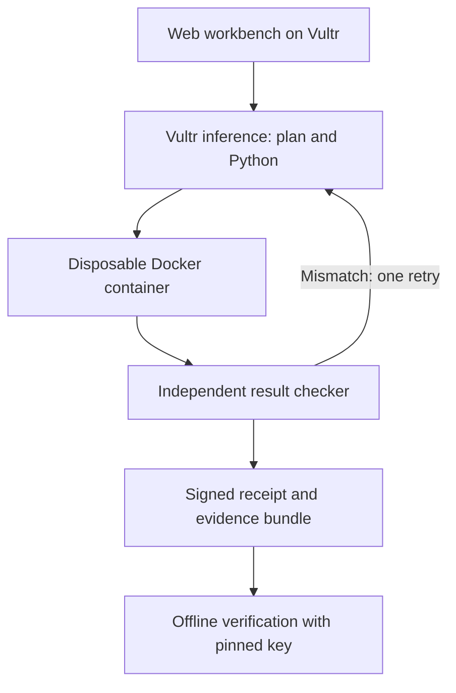

# ReceiptOps

**An invoice audit with evidence you can check after the run.**

ReceiptOps is a new prototype for the Vultr Agent Rush **Blast Radius Zero**
challenge, built by **Rama Chandra M**, AI Evaluation Lab. It uses a model to write
Python, executes that program inside a disposable Docker container, checks the
answer with a separate deterministic implementation, and signs an execution receipt.

**Live demo:** [Open ReceiptOps](http://155.138.211.247) — fictional sample data only.

**Verified on 9 November 2026:** Vultr inference generated the audit program;
the sandbox executed it; every result field passed independent recomputation.
All eight fixed containment checks passed. The downloaded audit and containment
receipts passed signature verification outside the VM. Altering the receipt is
rejected in the browser. [Signed evidence and pinned public key](evidence/vultr/).

**Automated checks:** 19 core/provider tests and 5 Docker integration tests pass
in [GitHub Actions](https://github.com/kaulastudies/ai-evaluation-lab/actions/runs/42556038894).
The source includes fixes found during deployment: JSON completion controls,
UFW web access, and the containment button's POST method.

**Submission status:** not submitted. LabLab shows the event as ended and blocks
submission outside its active phase. A reopening request was sent to the organizer.

## Why this exists

A confident answer is not enough when an agent is doing operational work.
A reviewer needs to know which input was used, what ran, whether the answer was
checked, and whether the record changed afterward. ReceiptOps makes those checks
part of one workflow. The initial use case is a small fictional invoice ledger:
outstanding balances, overdue invoices, and duplicate IDs.

The agent does not approve or move money. Duplicate rows stay in the totals and
are flagged for review. The fixed as-of date is **2026-11-08**.

## Workflow



The checker never imports or executes model-generated code. It independently
recomputes every result field from the original CSV using Decimal arithmetic.
Inference receives the task contract and schema, **not invoice rows**.

## Vultr deployment

- **Vultr Cloud Compute:** a dedicated Ubuntu VM runs Nginx, FastAPI, the trusted
  orchestrator, SQLite receipt storage, and Docker. Both frontend and backend
  are served from this VM. Vultr is the execution and control layer.
- **Vultr Serverless Inference:** the OpenAI-compatible chat-completions endpoint
  generates the plan and program. No other model provider is used by this app.
- **Docker:** each program gets a new container, no network, a read-only root
  and input mount, UID 65534, all capabilities dropped, no-new-privileges,
  128 MiB memory, 0.5 CPU, 32 processes, a bounded output pipe, and an 8-second
  execution deadline. A 16 MiB noexec/nosuid tmpfs is disposable.
- API and signing keys stay in the trusted host service. They are not passed
  into the execution container. The Docker socket is never mounted in it.
- The controller force-removes the named container in a finally block. A run
  cannot pass verification unless cleanup was confirmed.

The application does not execute generated code on the host when Docker is
unavailable. It returns a blocked status. The public demo accepts only its
fictional fixture, serializes runs, limits daily executions, and rate-limits
expensive endpoints at Nginx.

## Run locally

Python 3.12+, Docker Engine, and a Vultr Serverless Inference subscription are
required for live execution.

```bash
python3 -m venv .venv
. .venv/bin/activate
pip install -r requirements.txt
docker pull python:3.12-slim
export VULTR_INFERENCE_API_KEY='YOUR_KEY'
export VULTR_MODEL='MODEL_ID_FROM_YOUR_VULTR_MODEL_LIST'
python -m uvicorn receiptops.main:app --host 127.0.0.1 --port 8000
```

Do not commit keys. For deployed use, supply them in `/etc/receiptops.env` with
mode 0600. The public deployment allows 60 runs per day and 100 runs in total,
counting failed attempts toward the budget. Each audit allows at most two model
calls with 2,200 output tokens each. These app limits do not stop the VM's hourly
charges or govern other use of the account's inference credentials.
`deploy/install.sh` installs the service on a dedicated Ubuntu VM
and pins the pulled sandbox image by its resolved digest. See the
[deployment guide](deploy/README.md) for the private cloud-init generator.

## Verify a downloaded result

Obtain the public key through a separately trusted channel. Do not trust a
substituted key merely because it is included in a bundle.

```bash
python verify_bundle.py evidence.json --public-key receiptops-public-key.txt
```

This command verifies the Ed25519 signature and the input/code/stdout hashes,
recomputes the invoice answer, and checks the recorded execution verdict. It
does not run the supplied code or call a model. Editing an amount or swapping
an input causes rejection. A legitimately signed but incorrect result also fails.

**Scope:** signatures authenticate records under a trusted key. They do not prove
that the signing host is honest or provide hardware attestation. Docker shares
the host kernel and is not a complete defense against all container escapes.
The controller has Docker access and is part of the trusted computing base.

## Validation

```bash
python -m unittest discover -s tests -v
node --check receiptops/static/app.js
# Requires Docker and the execution image:
python -m unittest discover -s tests -p integration_sandbox.py -v
```

Tests cover exact money arithmetic, due-date boundaries, duplicate handling,
invalid rows, type confusion, prompt-like text treated as data, key persistence,
signature mutation, recomputed-hash attacks, untrusted signers, swapped input,
signed wrong answers, and the absence of a host-execution fallback. Unit test
fixtures are explicitly synthetic and are not offered as live sandbox evidence.

The Docker integration run exposed an output-flood cleanup deadlock. The
controller now detaches the output client before forcing container removal;
the regression passes in the linked run. This is CI evidence, not a Vultr
model execution.

In the browser, the containment panel runs network, read-only input, read-only
root, non-root user, secret environment, Docker socket, timeout, and cleanup
checks. Each observation is signed. A failed probe stays failed.

## Judge path

1. Open the public workbench and confirm services are ready.
2. Run the fictional invoice audit. Inspect the generated code and checked result.
3. Download its evidence bundle and public key.
4. Run the containment probes and inspect the signed observations.
5. Verify the receipt, then choose **Try a tampered copy** and observe rejection.
6. Run the offline verifier against the downloaded bundle.

## Boundaries and next steps

This prototype checks one explicit invoice contract, not arbitrary business
questions. The UI does not accept private data in public mode. A private
deployment needs authentication, TLS, tenant separation, retention controls,
and operational monitoring before real customer use. Fixed containment probes
are observations of controls, not penetration-test certification.

This code was created for Agent Rush on 8 November 2026 (UTC). It draws on the
Lab's prior approach to independent verification; no prior hackathon submission
is presented as newly executed Vultr work. Original code in this directory is
MIT licensed. Dependencies retain their own licenses.

Official references: [event and challenge rules](https://lablab.build/ai-hackathons/vultr-hackathon),
[Vultr Serverless Inference](https://docs.vultr.com/products/compute/serverless-inference/provisioning),
[Docker runtime controls](https://docs.docker.com/engine/containers/run/).
